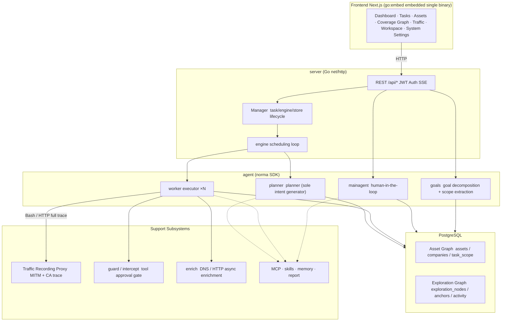
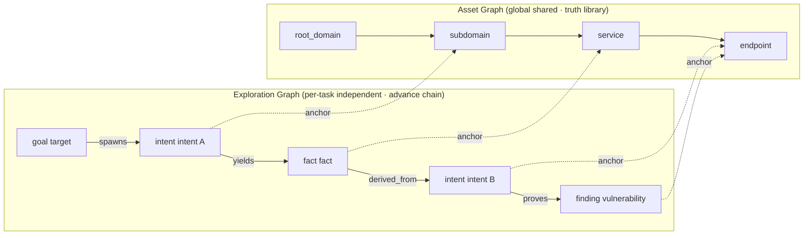
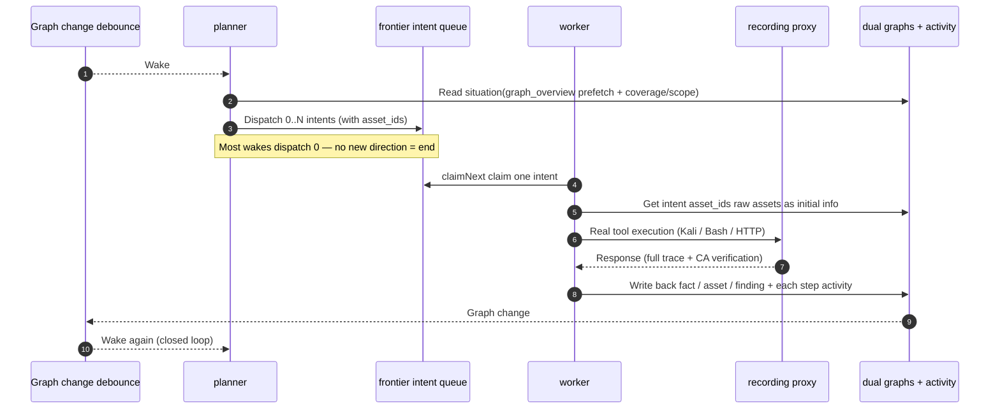
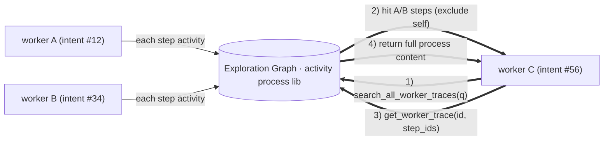
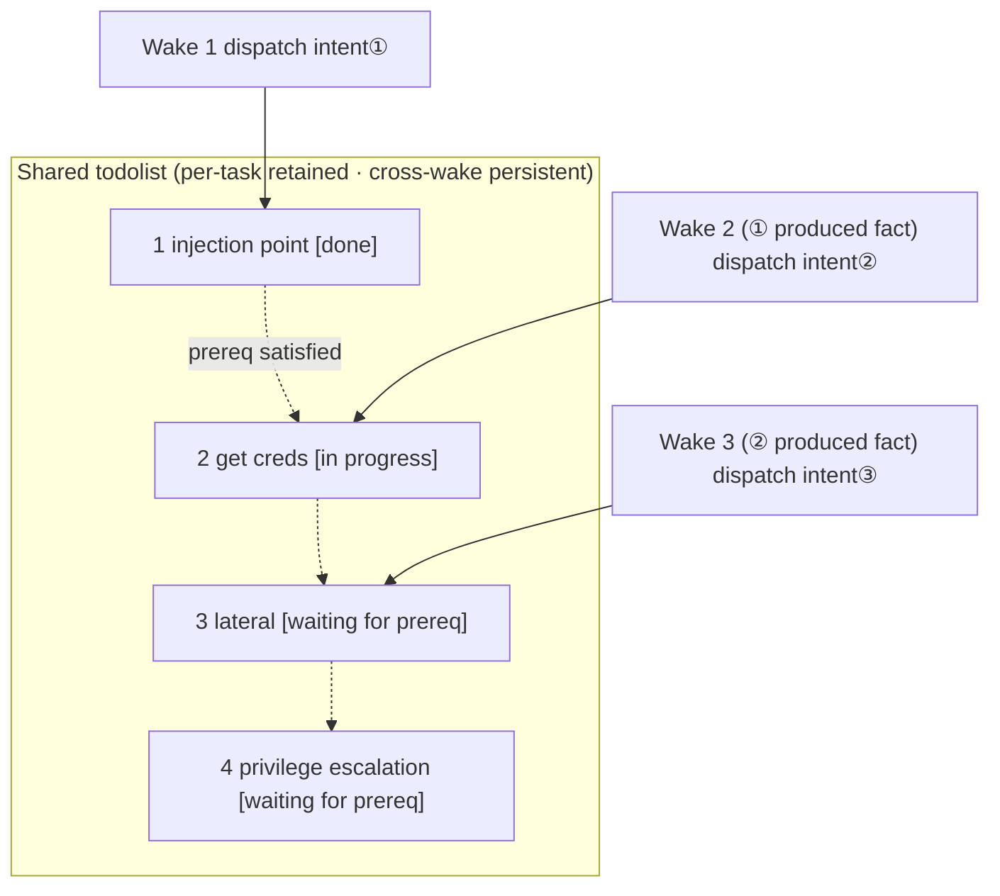

<div align="center">

# ARTEX

AI Autonomous Penetration Testing System (Go Backend + Next.js Frontend)


🌐 **Online Demo**: [https://artex-demo.vercel.app/](https://artex-demo.vercel.app/)

📦 **This repository is a pure source code backup of the last version of ARTEX; Docker deployment source is unavailable, just let AI build locally**

</div>

---

## Screenshots Preview

> Full interaction see [Online Demo](https://artex-demo.vercel.app/).

| Dashboard (Overview / Token Consumption / Activity Stream) | Task List |
| :---: | :---: |
|  |  |

| Task · Execution Process (Sessions / Tool Calls) | Exploration Chain |
| :---: | :---: |
|  |  |

| Findings | Assets |
| :---: | :---: |
|  |  |

| Asset Coverage Graph (Force-directed Layout · Tested Highlighted · Node Collapse/Expand) |
| :---: |
|  |

| Traffic Recording | Human-in-the-loop Dialog |
| :---: | :---: |
|  |  |

| Agent Management | LLM Config |
| :---: | :---: |
|  |  |

| Intercept Approval | Backend Logs |
| :---: | :---: |
|  |  |

---

## Approval Record Details

Global "Approval Records", task-level "Intercept Approvals", and approval cards in dialogs all support expanding to view details. Display structure references [AegisHook's approval detail component](https://github.com/RuoJi6/AegisHook/blob/main/web/src/components/CallDetail.vue), reusing ARTEX's components and theme:

---

## Asset Sync (ScopeSentry)

Supports syncing asset data directly from [ScopeSentry](https://github.com/Autumn-27/ScopeSentry), eliminating duplicate collection:

- In the "**Asset Sync**" page, enter ScopeSentry's address and API Key to connect the data source;
- Select targets and asset types to sync by **project** or **task** dimension (domains / subdomains / IPs / ports / sites / endpoints...);
- One-click import and merge by company asset scope, directly entering ARTEX's asset graph for agent exploration use.

---

## Installation

> Requires database **PostgreSQL**; exploration requires **LLM** configuration (`ANTHROPIC_API_KEY` or `OPENAI_API_KEY`, also configurable in UI).

### Method 1: One-click Install Script (Recommended)

```bash
git clone https://github.com/Autumn-27/ARTEX.git
cd ARTEX
./install.sh
```

Script will: detect / auto-install Docker → let you choose **① All Docker** or **② Local Compile & Run**:

- **① All Docker**: Enter a Postgres password (press Enter for random) → auto-write `.env` → `docker compose up -d`.
- **② Local Run**: Select database (connect existing / spin up one with Docker) → generate `config.json` → `go` compile embedded single binary → start.

After installation, open **http://localhost:8787** (first visit goes to `/setup` to set admin password).

### Method 2: Docker Compose (Manual)

```bash
git clone https://github.com/Autumn-27/ARTEX.git
cd ARTEX
cp .env.example .env          # Fill POSTGRES_PASSWORD, optional ANTHROPIC_API_KEY
docker compose up -d          # Pull autumn27/artex image + postgres
# → http://localhost:8787
```

Image includes common tools (ripgrep/curl/vim/npm/nmap...); `./skills` and `./data` persist via bind mounts.

Remote MCP can select `http` (Streamable HTTP) or `sse` (legacy SSE) in system settings.
Legacy SSE services typically use `GET /sse` to establish event stream, then receive JSON-RPC requests via service-returned `/message?sessionId=...`; configure URL as `/sse`, fill request header as `Authorization=Bearer <token>`.

### Method 3: Download Pre-compiled Binary (Releases)

Go to [Releases](https://github.com/Autumn-27/ARTEX/releases) to download zip for your platform, extract to get `artex` + `start.sh` (Windows: `start.bat`) + `skills/` + `config.example.json`:

```bash
cp config.example.json config.json   # Fill database connection
./start.sh                           # → http://localhost:8787
```

> Use `start.sh` / `start.bat` to start, not directly run `./artex`. It's a guardian script: after program exits, decides whether to restart based on exit code; **the [one-click update on the page](#method-1-page-one-click-update-recommended) relies on it to complete swap**. Directly running `./artex` means it won't be restarted after update.
> Background persistence: `nohup ./start.sh >artex.log 2>&1 &`.

### Method 4: Compile Single Binary from Source

```bash
# 1) Frontend static export
cd web && npm ci && npm run build:static && cd ..
# 2) Copy to embed directory
cp -r web/out server/webui/dist
# 3) Compile (-tags embedui required to embed frontend)
CGO_ENABLED=0 go build -tags embedui -o artex ./cmd/artex
./start.sh
```

### Method 5: Build Cross-platform Release Packages

`build.sh` builds and embeds frontend first, then uses Go linker to strip debug info, and compresses release files to zip. Release mode defaults to generating Linux amd64/arm64, macOS amd64/arm64, and Windows amd64 zip packages:

```bash
./build.sh --release
# Output: dist/artex-0.3.3-*.zip
```

UPX self-extracting binaries may be incompatible with some Linux kernels, virtualization environments, or security policies, so not enabled by default. Use `ARTEX_TARGETS` to customize targets; when target runtime confirmed compatible, explicitly pass `--upx` to further shrink binary:

```bash
ARTEX_TARGETS=linux/amd64,windows/amd64 ./build.sh --release
./build.sh --target linux/amd64 --upx
```

---

## Update & Upgrade

> Upgrade only replaces program, not data: Postgres data volume `pgdata`, `./data` (jwt.key / SQLite etc.), `./skills` are all preserved. **No manual database migration needed** — `artex` runs `schema.sql` idempotently on every start (including `ADD COLUMN` / `CREATE INDEX IF NOT EXISTS`), i.e., "restart = migrate". Still recommended to backup `./data` and database before upgrade.

### Method 1: Page One-click Update (Recommended)

In the **System Settings** page (sidebar "System Settings" → `/system/settings`) **Version & Update** card, you can directly check and install new versions without logging into server.

Click "Update": download current platform's release package → verify Release's `SHA256SUMS` → smoke test new binary with `-h` → stage as `artex.new` → program exits, `start.sh` / `start.bat` restarts and completes swap. Page auto-refreshes when new version comes online.

- **Failure leaves no bad binary**: verification or smoke test fails → discard staged file, continue running current version; if new version fails to start 3 times consecutively, auto-rolls back to `artex.old` (failed one kept as `artex.failed` for investigation).
- **Rollback anytime**: previous version kept as `artex.old`, card has "Rollback to previous version". Note: database schema does not rollback.
- **Update interrupts running tasks** — update = restart, perform during idle time.
- **Dev builds don't get updates**: version is `dev` or `git describe` with suffix → disabled, avoids release overwriting local debug binary.
- **Docker only swaps program, not image**: image's playwright / nmap etc. toolchains don't upgrade with it, and `docker compose up -d` rebuilds container back to image's version. To upgrade image too, still use `docker compose pull artex && docker compose up -d artex`.
- If GitHub access needs proxy, configure **global proxy** on same page; update pipeline will use it. Updates only download from GitHub domain with forced HTTPS.

### Method 2: One-click Update Script

```bash
cd ARTEX
./update.sh
```

Script optionally `git pull` latest code first, then lets you choose **① Docker Update** or **② Local Compile Update** (corresponds to `install.sh`):

- **① Docker**: Specify target image tag (Enter to reuse `.env`'s `ARTEX_TAG`, default `latest`) → `docker compose pull` → `docker compose up -d` (swap new image restart = auto migrate).
- **② Local**: Rebuild frontend static assets → recompile `./artex` (restart process after completion to take effect).

### Method 3: Docker Compose (Manual)

```bash
cd ARTEX
git pull                       # Update compose / scripts (optional)
# Specify version: set ARTEX_TAG=v0.2.0 in .env; if not set, uses latest
docker compose pull artex
docker compose up -d artex     # Swap new image restart → auto migrate schema
docker image prune -f          # Clean old images (optional)
```

### Method 4: Pre-compiled Binary (Releases)

Go to [Releases](https://github.com/Autumn-27/ARTEX/releases) to download new version zip, stop old process, overwrite `artex` and `skills/` (keep your `config.json` and `data/`), restart:

```bash
cp -r <extract_dir>/skills ./ && cp <extract_dir>/artex ./
./start.sh
```

### Method 5: Compile from Source

```bash
git pull
cd web && npm ci && npm run build:static && cd ..
cp -r web/out server/webui/dist
CGO_ENABLED=0 go build -tags embedui -o artex ./cmd/artex
# Restart ./start.sh
```

---

## Configuration

**Database** (`config.json`, or override with env var `ARTEX_PG_DSN`):

```json
{
  "database": {
    "host": "127.0.0.1", "port": 5432,
    "user": "artex", "password": "yourpass",
    "dbname": "artex", "sslmode": "disable"
  }
}
```

**LLM**: `export ANTHROPIC_API_KEY=sk-...` (or `OPENAI_API_KEY`), also fillable in UI's "LLM Config" page.
Optional: `ARTEX_LLM_PROVIDER` / `ARTEX_LLM_MODEL` / `ARTEX_LLM_BASE_URL` / `ARTEX_LLM_PROXY`.

**Concurrency**: Work agents per task configured in "System Settings" (default 3).

**Common params**: `./start.sh -addr :8787 -proxy :8788` (`-addr` frontend+API, `-proxy` traffic recording proxy). Start script passes params directly to `artex`.

### Reverse Proxy Deployment (HTTPS / Only expose 443)

Frontend and API/SSE are both served from same backend port (default `:8787`), real-time activity stream defaults to **same-origin** address, so **no need to configure `NEXT_PUBLIC_SSE_BASE`**, public only exposes 443, keep 8787 internal.

SSE is long-lived connection + continuous push; reverse proxy **must disable buffering**, otherwise browser connects but receives no events (activity stream keeps spinning). Nginx example:

```nginx
server {
    listen 443 ssl;
    server_name your.domain.com;
    # ssl_certificate / ssl_certificate_key ...

    location / {
        proxy_pass http://127.0.0.1:8787;
        proxy_set_header Host $host;
        proxy_set_header X-Forwarded-Proto $scheme;

        # SSE critical: disable buffering, long timeout, HTTP/1.1
        proxy_buffering off;
        proxy_cache off;
        proxy_read_timeout 3600s;
        proxy_http_version 1.1;
        proxy_set_header Connection "";
    }
}
```

> Only when SSE needs different origin from page (e.g., separate subdomain) should `NEXT_PUBLIC_SSE_BASE` be set at **build time** (variable baked into static bundle at `next build`, setting at container runtime ineffective).

---

## Development

### Manual Vulnerability Retest

Task detail's "Retest" tab allows paginated selection of this task's vulnerabilities, view historical conclusions and evidence, and manually trigger retest. After start, retains current tab, shows spinner and "Retesting"; after confirming fix, syncs vulnerability status.

Click "Retest" in each row of vulnerability list, or "Start Retest" in vulnerability detail's "Vulnerability Retest" area, fill optional fix version, test conditions or restrictions; system creates independent retest Agent session, retains current page after start. List's flat view, task-grouped view, and asset view all support this entry; retest running shows spinner and "Retesting", click to enter corresponding session to view, ends restores "Retest". Retest doesn't require restarting original scan task; conclusions: "Still Reproducible", "Fixed", "Cannot Confirm"; each conclusion, evidence, and session link saved in vulnerability detail.

New backend first startup presets editable "Vulnerability Retest" (`retester`) Agent, configurable in Agent Management for prompt, LLM, runtime budget, and tools. Defaults to its bound LLM, falls back to global active config if unbound. Retest session completes successfully with conclusion "Fixed" → system auto-sets vulnerability disposition to "Fixed"; running, failed, stopped, or other conclusions retain original status. Original evidence and reports always preserved. Can also manually select "Fixed" in status dropdown. Same vulnerability retesting reuses existing session; stopped, failed, or service restart allows new retest.

This version's history viewed via vulnerability detail and sessions, not yet in vulnerability report export or task archive packages, nor auto-linked to traffic packages. Demo mode only generates explicitly marked mock records, doesn't request real targets.

### Local Run & Test

```bash
./dev.sh    # Backend(:8787) + Traffic Proxy(:8788) + Frontend next dev(:5173) → http://localhost:5173
```

- Backend: `go run ./cmd/artex` (without `-tags embedui` doesn't embed frontend)
- Frontend: `cd web && npm run dev` (`/api` proxies to backend, with hot reload)
- Test: `go test ./...`
- Mock preview (no backend): `cd web && NEXT_PUBLIC_MOCK=1 npm run dev`

---

## System Technical Architecture

ARTEX is an **LLM multi-agent driven autonomous penetration system**: Go monolithic backend (embedded Next.js frontend) + PostgreSQL, agent capabilities provided by [`norma`](https://github.com/Autumn-27/norma) SDK (`agentcore` / `tool` / `permission` / `harness` / `memory` / `transcript`). Core is **dual-graph architecture**, plus two autonomy mechanisms around it: **worker inter-process information exchange** and **planner multi-round shared todolist stabilizing attack chains**.

### Overall Layers



| Layer | Responsibility |
| --- | --- |
| **Frontend** | Next.js static export, `go:embed` embedded in single binary; visualizes tasks/assets/exploration chains/coverage graphs, human-in-the-loop dialog |
| **server** | `net/http` routing + JWT auth + SSE; `Manager` manages task/engine/DB store lifecycle |
| **engine** | One `plannerLoop` + N worker goroutines per task; intent claiming, timeout/pause/drain |
| **agent** | goals / planner / worker / mainagent, `ToolSet` exposes dual graphs as LLM tools |
| **db** | Dual graph Postgres persistence (pgx); schema with `go:embed` idempotent table creation on every start |
| **Support** | Recording MITM proxy, approval gate, async enrichment, MCP/skills/memory/report |

### Dual Graph Architecture: Exploration Graph + Asset Graph

The system splits "what is the target" and "how much was tested" into two independent yet anchor-connected graphs:

- **Asset Graph (global shared)**: Cross-task single source of truth for assets. Nodes: `root_domain / subdomain / ip / service / app / endpoint`, owned by companies; domain→subdomain→service→endpoint parent-child relationships and dedup keys all computed by program, agent only submits raw info.
- **Exploration Graph (per-task independent)**: One task's "thinking and advancing" process. Nodes: `goal / intent / fact / finding / hint`, connected by `spawns / derived_from / yields / proves` edges into **lineage chain**, answering "which direction derived from which facts, produced what".
- **Two graphs linked by anchors**: `exploration_anchors(node_id, asset_id)` anchors intents/facts/findings to specific assets — so you can see from "exploration direction" which assets it hits, and from "an asset" reverse-query which intents tested it this task, what facts derived. This also supports **asset test coverage** and **asset coverage graph** (in-scope assets + tested highlighting).



> Division of labor: **planner** reads exploration graph situation, determines targets, only dispatches **intents** to frontier when new uncovered directions exist; **worker** claims **one intent**, executes with real tools, writes new assets/facts/findings back to both graphs then stops. Asset graph is shared facts, exploration graph is per-task advance chain.

### Engine & Intent Lifecycle (One Exploration Closed Loop)

Engine is **event-driven** closed loop: graph changes wake planner, planner dispatches intents, workers claim intents execute and write back, writeback triggers next round — until target proven (`prove_goal`).



### Worker Inter-process Information Exchange

In a deep exploration, many valuable observations (an error, a response segment, a hidden param) appear in a worker's **execution process** but not necessarily written as formal facts. To avoid duplicate work, let chain workers stand on each other's shoulders, workers have **cross-work trace retrieval** capability:

- `search_all_worker_traces(q)`: keyword search in **other works' execution processes** of this task (auto-excludes own intent's steps), hits include `intent_id`;
- `list_worker_traces` / `get_worker_trace(intent_id, step_ids=[…])`: first see which works ran, then fetch specific steps of a work for detailed exchange.

Thus even without corresponding fact on exploration graph, subsequent workers can reuse observations from others' processes — **information flows between workers at "execution process" granularity**, while boundaries unchanged (each worker still only does its claimed intent).



### Planner Multi-round Shared Todolist → Stable Attack Chain

Real attack chains are often **multi-step sequences with dependencies** (e.g., find injection → get creds → lateral → privilege escalation), dispatching all in parallel at once only causes chaos. Planner therefore holds a **per-task retained, cross-wake shared planning todo (todolist)**:

- Planner is event-driven — wakes on graph change, but **each wake is a fresh session**; shared todolist lets it **record a serial exploit chain once**, then in subsequent rounds **dispatch intents step by step per dependency**, not pre-expand entire chain in one round;
- Each round only dispatches next step for "prerequisite steps completed, dependent facts exist", and updates list as progress advances (marks steps satisfied by facts as done).



Thus attack chain remains **stable advance, no duplicates, no disorder** in "event-driven + stateless session" environment — this is the key to ARTEX autonomously completing multi-step exploit chains.

---

## Community

Scan to follow WeChat official account **SecSentry**, DM in official account backend to join discussion group.

<div align="center">


</div>

---

## References

https://github.com/oritera/Cairn


## License & Disclaimer

### Open Source License

This project is licensed under **GNU Affero General Public License v3.0 (AGPL-3.0)**, full terms in repo root [LICENSE](LICENSE).

This means anyone can freely use, modify, and distribute this project, but **derivative works must also be AGPL-3.0 open source**; especially, **if you modify this project and provide it to users over network (e.g., deploy as online service), you must also provide corresponding complete source code to those users**.

> ⚠️ **Important Note**: The open source license itself does not restrict software usage. The following "Usage Restrictions" and "Disclaimer" are additional agreements and solemn declarations by the author to users; please strictly comply.

**ARTEX is for personal learning, code research, and local technical verification only; must not be used to initiate actual tests against any online systems or websites.**

### Permitted Use

- Only for **reading, learning, and researching this project's source code**, and for **technical principle verification in local isolated environments**;
- Applicable to personal learning, academic research, code review, and other non-attack purposes.

### Prohibited

- **Strictly prohibited to use this tool to initiate scans, probes, exploits, or attacks against any websites, online services, or networked systems** (regardless of authorization, regardless of own assets);
- Strictly prohibited to use this tool for any actual penetration testing, red teaming, or production environments;
- Strictly prohibited to use this tool for illegal intrusion, data theft, ransomware, denial of service, or any destructive/criminal activities;
- Strictly prohibited to use this tool for activities violating laws/regulations of your country/region.

### Compliance Responsibility

User must comply with all laws/regulations of their country/region regarding cybersecurity, data protection, and computer crimes (in mainland China including but not limited to Cybersecurity Law, Data Security Law, Personal Information Protection Law, and related judicial interpretations). **All legal liabilities and consequences arising from use of this tool are borne solely by the user.**

### Disclaimer

This project is provided "AS IS" without any express or implied warranties. Authors and contributors are not liable for any direct or indirect losses, data loss, system damage, or legal disputes caused by using this tool (regardless of whether usage is proper). **Downloading, installing, or using this project constitutes acknowledgment that you have read, understood, and agreed to all above terms.**