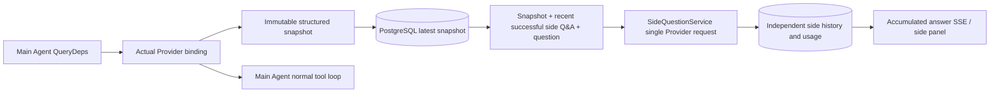

# ARTEX `/btw`

Plain chat, task MainAgents, and a task's own Workers support standalone side questions. Type `/btw question` in the main input box to submit; an empty `/btw` or the "side question" button opens history. Desktop uses a resizable sidebar, mobile uses a Drawer.

Side answers are generated from the Agent context snapshot taken at submission time, with streaming display, follow-ups, stop, and clear. Closing the panel, refreshing the page, or dropping SSE never cancels the model request. Stopping affects only the current side request; clearing cancels the side request and deletes side history while keeping the main context snapshot.

## Implementation Boundaries

Reuses Go, norma v0.3.7, Next.js, and the existing Markdown / ResizablePanel / Drawer / AlertDialog components; no norma source changes and no new dependencies for side questions. Planners, Workers inherited from other tasks, and tool-type subtask upgrades are out of scope for this round.

- `capture.go` only marks main-loop requests at `Options.Deps.CallModel / CallModelSync`. The Provider decorator sits inside the concrete model, after outer routing-pool selection, so it records the actually selected model; compaction and summary requests do not overwrite the snapshot.
- Snapshots are published at request start, on complete model replies, and on run terminal states. Half-generated in-flight replies are not published; tool calls stay paired through norma's `MessagesForAPI`, and tool results enter the snapshot at the next main model request or run terminal state. Stream aborts keep the last valid boundary.
- Snapshots preserve structured messages, system prompts, tool definitions, and generation parameters via JSON deep copy. Model inference holds no snapshot lock or database transaction.
- `SideQuestionService` calls the concrete Provider; it generates a side summary first when needed, and the final answer may retry once after shrinking only on first-call context overflow with no text/tool-call output yet. It creates no agent session and touches no tool executor, main transcript, activity stream, or task graph, nor does it go through the task model-switch chain. Answers keep tool definitions to stay compatible with existing structured tool contexts; summary requests carry no tools. Newly returned tool calls have no execution path.
- One running request per parent session, at most four per service process, 120-second timeout each. Side requests use an independent cancellation context under the service lifetime.
- Side requests keep a model-config reference and a non-sensitive identity digest; credentials are fetched from the existing config at request time. When the config is deleted, or model/protocol/address identity fields change, the main Agent must run first to refresh the snapshot. Tests never change the product default model.

## Persistence and Recovery

`db/schema.sql` auto-creates `side_question_sessions` and `side_question_requests`. The former stores the parent resource, latest snapshot, run number, version, and cleanup version; the latter stores the question, accumulated answer, status, model, snapshot time, usage, event ordinal, and paging ordinal.

Parent session keys use the conversation ID, or task ID + exploration ID + intent ID. Workers do not use reusable execution-slot names.

Snapshots merge-write per parent session, flushed every 250 ms, with the database comparing `(run_id, version)` so stale versions cannot overwrite. The selected snapshot is saved again before side submission. The large in-memory snapshot is released after a successful save; the pending version is kept on failure. Accumulated answer content writes at most every 250 ms as stream events arrive, with the terminal state saved immediately and bounded retries on database errors.

On startup the service marks leftover `running` requests as `interrupted`, keeping the already-persisted partial answer and usage without replaying the request. The most recently saved context can serve the next question directly. Old sessions without a snapshot must run the main Agent first; context is never rebuilt from UI activity records.

Clearing bumps the cleanup version and deletes requests; conditional updates stop late callbacks from writing back. Physical parent deletion cascades via foreign keys; Worker logical deletion removes side data in the same transaction and rejects subsequent late snapshots. Task archiving blocks new requests first, waits for the main flow to stop, cancels and waits for side persistence; the archive format is v3 with v1/v2 (no side tables) still compatible.

History is fully saved, returning at most 20 items per page by ordinal cursor. Model requests replay at most the 20 most recent successful Q&A groups verbatim, further limited by token budget; older Q&A maintains an independent rolling summary. When the main context is over budget, only the old part of the side copy is summarized, keeping recent structured tool calls and results. Summaries, preparation progress, and usage all fall under the side request's concurrency, cancellation, and 120-second timeout limits. See [context budget and open-source references](CONTEXT_BUDGET.md).

## HTTP Contract

The following paths serve as `{parent}`, reusing existing auth and resource checks:

- `/api/conversations/{id}`
- `/api/tasks/{id}/chat`
- `/api/tasks/{id}/intents/{iid}`

| Request | Response and behavior |
| --- | --- |
| `GET {parent}/side-questions?before={ordinal}` | `items` newest-first, standalone `current` running state, `snapshot` metadata, `next_cursor`; cursor 0 means latest page / no next page |
| `POST {parent}/side-questions` | JSON `{ "question": "…", "client_request_id": "UUID" }`; a new request returns 202 plus the request object; same ID and question returns the existing object with 200 |
| `DELETE {parent}/side-questions` | Cancels and clears the current parent session's side Q&A |
| `GET /api/side-questions/{requestID}/events` | `snapshot` SSE events, `id` is an ascending ordinal, `data` is the full accumulated request object; `cleared` is sent on clear |
| `POST /api/side-questions/{requestID}/cancel` | Explicit cancel; terminal state readable from history or SSE |

Questions are capped at 4000 characters. Missing snapshot, changed model config, busy parent session, or idempotency-ID conflict returns 409; the global concurrency cap returns 429. Every SSE connection first sends the accumulated state without relying on text fragments the client received earlier. The frontend merges by request ID + ordinal and discards stale callbacks when switching parents or clearing.

## Verification and References

Automated checks, live model usage, and known limits are in [VALIDATION.md](VALIDATION.md).

Standalone requests follow [Grok CLI side-question.ts (pinned)](https://github.com/superagent-ai/grok-cli/blob/fb97af83f06dca873281d60168430f06c8de6324/src/utils/side-question.ts); run isolation follows [OpenCode (pinned)](https://github.com/anomalyco/opencode/tree/b3f1a96c6dd7adeb28b36dd11add1998fc84d67b). ARTEX context uses norma's structured messages instead of stitching text from frontend logs.
