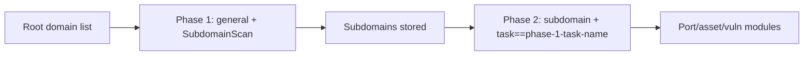

---

## name: scopesentry-mcp
description: Manage the ScopeSentry security scanning platform (projects, tasks, templates, assets, nodes) via ScopeSentry MCP. Use when the user mentions ScopeSentry, MCP, API Key, scan tasks, or asset queries.

# ScopeSentry MCP Usage Guide

For users with a **deployed ScopeSentry instance**. Connect to the platform via Cursor (or another MCP client); no local source code needed.

## 1. Prerequisites

### 1.1 Confirm the service is reachable

- Default web UI: `http://<host>`
- MCP endpoint: `http://<host>/mcp` (if there is a reverse proxy or frontend proxy in front, use the actual `/mcp` address)

### 1.2 Create an API Key

1. Log in to the ScopeSentry web UI in a browser
2. Open the **API Key** management page and create a key (or create one via an admin-provided interface)
3. Save the returned `ssk_...` string (**shown only once**)

### 1.3 Configure Cursor MCP

Cursor → Settings → MCP → add a server:

```json
{
  "mcpServers": {
    "scopesentry": {
      "url": "http://<your-host>:8082/mcp",
      "headers": {
        "X-API-Key": "ssk_your-key"
      }
    }
  }
}
```

Alternatively: `Authorization: Bearer ***`

After configuring, restart MCP or reload Cursor and confirm tools like `list_projects` and `list_assets` appear in the tool list.

---

## 2. Tool Overview


| Tool                   | Purpose                |
| ---------------------- | ----------------- |
| `list_projects`        | Project tree grouped by tag (with project IDs) |
| `list_projects_data`   | Paginated project list, searchable by name     |
| `get_project`          | Project details              |
| `create_project`       | Create a project              |
| `list_tasks`           | Scan task list            |
| `get_task`             | Task details              |
| `list_scan_templates`  | Scan template list            |
| `get_scan_template`    | Template details              |
| `list_plugin_modules`  | Scan pipeline module names          |
| `list_plugins`         | Available plugins (with hash, default params) |
| `create_scan_template` | Create a scan template            |
| `create_scan_task`     | Create a scan task            |
| `list_assets`          | Query assets of all kinds (paginated list)       |
| `count_assets`         | Count assets (`/api/assets/common/total`) |
| `get_asset_detail`     | Asset or vulnerability details           |
| `add_asset_tag`        | Add a tag to an asset           |
| `list_nodes`           | Scan node list            |


Tool parameters follow the MCP tool descriptions (schema); `list_assets` / `count_assets` share the same search/filter syntax — read the `list_assets` description before querying assets.

When you need to know "how many in total", use `count_assets` (matches the web page-total API) instead of paging through `list_assets` just to count.

---

## 3. Common Workflows

### 3.1 Query assets by project

When the user or context **already has a project condition**, pass `filter.project` to narrow the scope and avoid slow responses from cross-project data volume. With no explicit project, a project filter is not mandatory.

1. `list_projects` or `list_projects_data` to get the target project's **ObjectID** (`id` / `children[].value`)
2. `list_assets` with `filter.project` (**must be the ID, never the project display name**)

```json
{
  "asset_type": "asset",
  "pageIndex": 1,
  "pageSize": 20,
  "search": "domain=^example.com",
  "filter": {
    "project": ["<project-ObjectID>"]
  }
}
```

### 3.2 Create a scan task

1. `list_nodes` to get online node names
2. `list_scan_templates` or `create_scan_template` to get the template **ObjectID**
3. `create_scan_task`: `name` and `node` are required; `template` takes the template ID (never the template name)

**Target source `targetSource` (same as the web UI):**

| targetSource | Meaning | Required params |
| --- | --- | --- |
| `general` | Enter targets directly | `target` |
| `project` | Read targets from a project | `project` (project ObjectID array) |
| `asset` | Search the web asset library | `search`; optional `project`, `filter`, `targetNumber` |
| `RootDomain` | Search the root-domain library | `search`; optional `project`, `filter`, `targetNumber` |
| `subdomain` | Search the subdomain library | `search`; optional `project`, `filter`, `targetNumber` |
| `UrlScan` | Search URL scan results | `search`; optional `project`, `filter`, `targetNumber` |
| `*Source` (e.g. `subdomainSource`) | Create from asset-page "selected/searched" items | `search` when `targetTp=search`; `targetIds` when `targetTp=select` |

**Example — scan a root domain directly:**

```json
{
  "name": "example-subdomain-enum",
  "node": ["node-1"],
  "template": "<template-ObjectID>",
  "targetSource": "general",
  "target": "example.com\nfoo.com",
  "project": ["<project-ObjectID>"]
}
```

**Example — continue from the subdomain library (filter by previous task name):**

```json
{
  "name": "example-ports-and-vulns",
  "node": ["node-1"],
  "template": "<follow-up-module-template-ObjectID>",
  "targetSource": "subdomain",
  "search": "task==\"example-subdomain-enum\"",
  "project": ["<project-ObjectID>"]
}
```

### 3.3 Full root-domain recon (recommended two phases)

When the input is a **root domain** and you want **full recon**, run two scans instead of one full pipeline.

**Why:** distributed tasks dispatch by **single target**. With a root domain as the target, the node that receives it keeps executing follow-up modules on the subdomains it discovers — causing uneven load, slowness, and errors.

**Best practice:**

1. **Phase 1 — subdomain enumeration only**
   - `targetSource`: `general`
   - `target`: all root domains (multiple lines)
   - Template: enable only `SubdomainScan`, `SubdomainSecurity` (subdomain scan + subdomain takeover)
   - Wait for completion with `get_task`

2. **Phase 2 — follow-up modules**
   - `targetSource`: `subdomain`
   - `search`: `task=="<phase-1-task-name>"` (exact task-name match)
   - Optional `project` to narrow scope
   - Template: port scan, asset mapping, vulnerability scan, etc. (may omit SubdomainScan)
   - Subdomains dispatch to nodes as independent targets for better parallelism

The same result can be achieved in the web UI by filtering the "subdomain" asset page by task name and using "create task from subdomains".



### 3.4 Create a scan template

1. `list_plugin_modules` → module name list
2. `list_plugins` (optionally filtered by `module`) → each plugin's `hash` and default `parameter`
3. `create_scan_template`: use `modules` to specify "module → plugin hash array"

---

## 4. Asset Queries (`list_assets` / `count_assets`)

`count_assets` and `list_assets` take the same `asset_type`, `search`, `filter` and return `{ "total": N }`, matching the web `/api/assets/common/total`.

```json
{
  "asset_type": "subdomain",
  "search": "task==\"some-task-name\"",
  "filter": {"project": ["<project-ObjectID>"]}
}
```

**Performance tips (shared by `list_assets` / `count_assets`):** with a project condition, prefer `filter.project` to narrow scope; in `search`, use `==` exact or `^` prefix matches on indexed fields where possible (see [4.3](#43-search-expressions)) and avoid broad `=` fuzzy queries that slow responses. With no project context, a project filter is not mandatory.

See the [4.4](#44-filter-exact-filters) table for types supporting `filter.project`.

### 4.1 Asset types (`asset_type`)

`asset`, `RootDomain`, `subdomain`, `app`, `mp`, `UrlScan`, `SensitiveResult`, `DirScanResult`, `crawler`, `vulnerability`, `PageMonitoring`, `IPAsset`, `SubdomainTakerResult`

Alias examples: `web`→asset, `vuln`→vulnerability, `ip`→IPAsset, `url`→UrlScan

### 4.2 Parameter reference


| Parameter              | Meaning                                      |
| ------------------------ | --------------------------------------- |
| `pageIndex` / `pageSize` | Paging, defaults 1 / 20                            |
| `search`                 | Search expression (see next section)                              |
| `filter`                 | Exact-match filter JSON (see next section)                          |
| `sort`                   | Only UrlScan and DirScanResult support sorting by `length` |
| `sid`                    | SensitiveResult only: sensitive rule name                |


`search` and `filter` **may be used together**.

### 4.3 search Expressions

Custom DSL (**not SQL**):


| Operator | Meaning   | Index | Example                          |
| ---- | ---- | ---- | --------------------------- |
| `=`  | Fuzzy match (regex) | Not indexed | `domain=example`            |
| `==` | Exact match | **Indexed** | `port==443`                 |
| `!=` | Exclusion   | — | `port!="80"`                |
| `&&` | AND    | — | `domain==example.com && port==443` |
| `||` | OR    | — | `title=admin || body=login` |


**Indexes and operators:** fields like `domain`, `ip`, `port`, `title` are indexed, but only **`==` exact** matches or **prefix matches with a leading `^`** (e.g. `domain=^example.com`) use the index; **plain `=` becomes a regex fuzzy match that cannot use the index** and gets slow on large data.

**search fields shared by all types:** `tag`, `task` (task name), `rootDomain`

**project must not go in search** (invalid, or errors when combined with `&&`). Filter by project with `filter.project`.

**Common search fields per type:**


| asset_type           | Fields                                                                                  |
| -------------------- | ----------------------------------------------------------------------------------- |
| asset                | domain, ip, port, service, app, title, statuscode, icon, banner, type, body, header |
| RootDomain           | domain, icp, company                                                                |
| subdomain            | domain, ip, type, value                                                             |
| app                  | name, icp, company, category, description, url, apk                                 |
| mp                   | name, icp, company, category, description, url                                      |
| UrlScan              | url, input, source, resultId, type                                                  |
| SensitiveResult      | url, sname, body, info, md5                                                         |
| DirScanResult        | url, statuscode, redirect, length                                                   |
| vulnerability        | url, vulname, matched, request, response, level                                     |
| crawler              | url, method, body, resultId                                                         |
| PageMonitoring       | url, hash, diff, response                                                           |
| IPAsset              | ip, domain, port, service, webServer, app                                           |
| SubdomainTakerResult | domain, value, type, response                                                       |


**search examples:**

- `domain==www.example.com && port==443` (exact, indexed)
- `domain=^example.com` (prefix match, indexed)
- `ip==192.168.1.1`
- `task=="some-task-name"`
- `level==high` (vulnerability)
- `statuscode==200` (DirScanResult)

Use `=` for substring fuzz only when needed, e.g. `title=admin` (not indexed — pair with narrowing conditions like a project).

### 4.4 filter Exact Filters

JSON object: multiple values under one key are **OR**, different keys are **AND**.

**Prefer `project` when a project condition exists:** if the user or context already names a project and the asset_type supports `project`, include it to narrow scope; without project info it is not mandatory.


| filter key   | Meaning       | Value notes                                                     |
| ------------ | -------- | -------------------------------------------------------- |
| `project`    | Owning project     | **ObjectID**, from `list_projects` / `list_projects_data` |
| `task`       | Source task     | **Task name**, the `name` from `list_tasks`                         |
| `port`       | Port       | e.g. `"443"`                                                |
| `service`    | Service/protocol    | e.g. `"https"`                                              |
| `app`        | App fingerprint     | e.g. `"Nginx"`                                              |
| `icon`       | Icon hash  |                                                          |
| `statuscode` | HTTP status code | Mainly for asset                                               |
| `status`     | Status       | UrlScan/DirScan HTTP code; vuln/sensitive-info processing status                       |
| `level`      | Vuln severity     | critical / high / medium / low / info                    |
| `type`       | Type       | e.g. subdomain record types A, CNAME                                         |
| `color`      | Sensitive-rule color   | SensitiveResult                                          |
| `sname`      | Sensitive-rule name    | SensitiveResult                                          |
| `tags`       | Tags       |                                                          |


**filter keys available per type:**


| asset_type                            | filter key                                                      |
| ------------------------------------- | --------------------------------------------------------------- |
| asset                                 | project, port, service, app, icon, statuscode, type, task, tags |
| RootDomain                            | project, tags                                                   |
| subdomain                             | project, type, task, tags                                       |
| app / mp                              | project, tags                                                   |
| UrlScan                               | status, tags                                                    |
| DirScanResult                         | status, tags                                                    |
| SensitiveResult                       | status, color, sname, tags                                      |
| crawler                               | project, task, tags                                             |
| vulnerability                         | project, level, status, task, tags                              |
| PageMonitoring / SubdomainTakerResult | tags                                                            |
| IPAsset                               | project, port, service, app                                     |


**filter example:**

```json
{"project": ["<project-ObjectID>"], "port": ["443"]}
```

**Combined query example:**

```json
{
  "asset_type": "asset",
  "search": "domain=^baidu && port==443",
  "filter": {"project": ["<project-ObjectID>"]},
  "pageIndex": 1,
  "pageSize": 10
}
```

**Notes:**

- With a project condition, prefer `filter.project` (where supported); without project context it is not mandatory
- Never put the project display name in `filter.project`
- Use `==` for known values, `^` for prefixes; avoid abusing `=` fuzzy matches on big tables
- UrlScan HTTP status uses `filter.status`; DirScanResult can use `statuscode==200` in search
- SensitiveResult by rule name: `sname=rule-name` in `search`, or `filter.sname`

### 4.5 Sorting (sort)

Only **UrlScan** and **DirScanResult** support it:

```json
{"length": "ascending"}
```

Other types ignore `sort` and order by time by default.

---

## 5. Scan Template Module Names

`TargetHandler`, `SubdomainScan`, `SubdomainSecurity`, `PortScanPreparation`, `PortScan`, `PortFingerprint`, `AssetMapping`, `AssetHandle`, `URLScan`, `WebCrawler`, `URLSecurity`, `DirScan`, `VulnerabilityScan`, `PassiveScan`

---

## 6. Troubleshooting


| Symptom        | Fix                                                 |
| --------- | -------------------------------------------------- |
| MCP shows no tools   | Check the URL, API Key, and whether ScopeSentry is running                    |
| 401 / 403 | Recreate or replace the API Key                                    |
| Assets not found     | Confirm `filter.project` is an ObjectID; never put project in search |
| Template/task creation fails | `template` must be a template ObjectID; `node` takes an online node name            |
| Slow/stuck queries   | With a project, add `filter.project`; switch indexed-field search to `==` or `^` prefix, use `=` sparingly; shrink `pageSize` |


---
